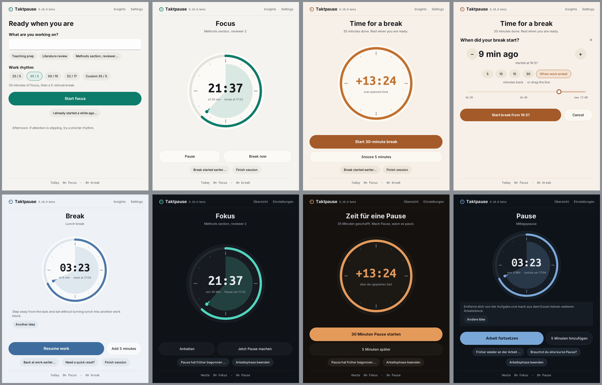
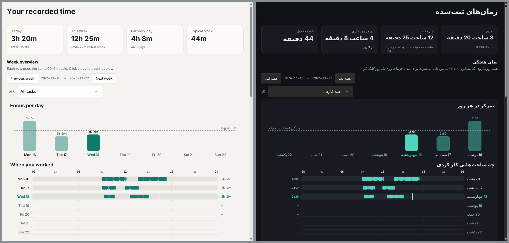

# Taktpause

A calm, offline work and break timer for long reading and writing days.
For Windows and Ubuntu Linux, in English, German and Persian.



## What it does

- Start focus or a break with one click. Forgot to press start?
  "Started earlier" moves the start time back.
- Gentle reminders for breaks, water and lunch. Optional mild humour, off by
  default.
- One main action per screen, and a soft colour for each state: green for
  focus, blue for breaks, sand when the planned time is over.
- A small round floating timer while the window is minimized (optional).
- Insights: when you worked, per day and per task, without productivity scores.
- Your own wording for reminders.



## Privacy

All data stays on your computer. Taktpause works offline and has no account,
cloud sync or telemetry. On Ubuntu, the snap has no network permission at all.

## Download

All files are on the [Releases](https://github.com/Farid-python/taktpause/releases)
page. GitHub Actions builds them from the code in this repository; nobody
builds them on a private computer.

### Windows

1. Download `Taktpause.exe`.
2. Put it in any folder and double-click it. No installation and no Python
   needed.

The file is not code-signed yet, so Windows SmartScreen may show a warning.
Click "More info", then "Run anyway".

### Ubuntu

1. Download `taktpause_<version>_amd64.snap`.
2. Install it from a terminal in the download folder:

   ```sh
   sudo snap install --dangerous ./taktpause_*_amd64.snap
   ```

`--dangerous` only means that the snap does not come from the Snap Store, so
it does not update itself. Install a newer release the same way.

### Check that a file is genuine

Each release has `SHA256SUMS.txt` with the checksum of every file. Each file
also has a signed build record (attestation) that shows which workflow run
built it from which commit. With the [GitHub CLI](https://cli.github.com/):

```sh
gh attestation verify Taktpause.exe --repo Farid-python/taktpause
```

## Run from source

Python 3.12 with Tkinter is the tested version.

```sh
python -m pip install -r requirements.txt
python taktpause.py
```

On Ubuntu, first install Tkinter: `sudo apt install python3-tk python3-venv`.
Run the built-in checks with `python taktpause.py --self-test`.

## Build it yourself

**Without installing anything (fork):**

1. Click **Fork** at the top of this page.
2. In your fork, open the **Actions** tab and enable workflows.
3. Choose **Build**, then **Run workflow**.
4. When the run is finished, download `Taktpause-windows` and
   `Taktpause-snap` at the bottom of the run page.

**On your own Windows computer:**

```sh
python -m pip install -r requirements.txt -r requirements-build.txt
python packaging/windows/build.py
```

The result is `dist/Taktpause.exe`.

**On your own Ubuntu computer:** install `snapcraft` and LXD, then run
`snapcraft pack` in the project folder.

## Licence

Taktpause is free software under the
[GNU General Public License version 3](LICENSE), with one
[additional term](ADDITIONAL_TERMS.md) under section 7(b):

- You may use, study, share and change Taktpause.
- If you share a changed version, it must also be under GPL-3.0, with its
  source code.
- The About window, and the source code, must keep "Created by Farid Rezaei"
  and "Copyright © 2026 Farid Rezaei". You may add your own name for your
  changes.

## Author

Created by [Farid Rezaei](https://www.linkedin.com/in/farid-rezaei-bremen/),
researching AI and marketing, in the Hanseatic City of Bremen.

Taktpause is a beta. If something breaks or gets in your way, please
[open an issue](https://github.com/Farid-python/taktpause/issues).
